<div align="center">



<br>

<a href="https://thiagodanjos.github.io/lisfilms-demo/"></a>
<a href="https://lisfilms.pt"></a>
<a href="https://github.com/thiagodanjos/lisfilms-demo/actions/workflows/deploy.yml"></a>


<a href="LICENSE"></a>

</div>

<br>

> [!NOTE]
> Isto é a **demonstração pública**. O LisFilms a sério, com contas, o catálogo real e o LisGames, está em
> **[lisfilms.pt](https://lisfilms.pt)**.

Esta demo mostra o essencial do **LisFilms**, uma rede social de filmes e séries: o catálogo, a ficha de cada
título, as críticas, o feed, os perfis e a watchlist. Corre inteira no navegador, com dados inventados para ela,
sem servidor, sem contas e sem chaves de API. O que fazes (guardar um título, gostar de uma crítica, escrever a
tua) fica só no teu navegador.

**[Experimenta a demo →](https://thiagodanjos.github.io/lisfilms-demo/)**

<br>

## Ecrãs



<sub>Capturas da própria demo, com os dados fictícios que ela traz (mais um título na watchlist e uma crítica
escrita no navegador, para se ver como fica). Estão todas em [`docs/capturas`](docs/capturas).</sub>

### No telemóvel



## O que podes fazer



Os títulos, as pessoas e as críticas foram inventados para esta demo: não há cartazes nem sinopses reais. Cada
título tem um «cartaz» em gradiente, com a sua cor, e é isso que vês nas imagens acima.

## A demo e o LisFilms real



O LisFilms começou como a minha PAP (Prova de Aptidão Profissional), em Python e Tkinter, e cresceu para um site
em produção com API própria e uma app para Windows. Esse código não é público, por isso esta demo foi feita de
raiz para o portefólio: mostra a experiência e a identidade visual sem expor nada da app real.

## Como funciona



```
src/
├── components/   AppShell (barra lateral, pesquisa, navegação no telemóvel) e peças de interface
├── data/         tipos e dados fictícios: títulos, pessoas e críticas
├── pages/        uma página por rota
├── store/        estado local (Zustand), guardado no localStorage
└── lib/          utilitários
```

Feito com [React 19](https://react.dev), [TypeScript](https://www.typescriptlang.org),
[Vite](https://vite.dev), [Tailwind CSS 4](https://tailwindcss.com), [React Router](https://reactrouter.com),
[Zustand](https://zustand-demo.pmnd.rs) e ícones [Lucide](https://lucide.dev).

## Correr no teu computador

Precisas do [Node.js](https://nodejs.org) 22. Não há nada para configurar:

```bash
git clone https://github.com/thiagodanjos/lisfilms-demo.git
```

```bash
cd lisfilms-demo
```

```bash
npm install
```

```bash
npm run dev
```

Abre http://localhost:5173/lisfilms-demo/. Para compilar como no GitHub Pages: `npm run build` (fica em `dist/`)
e `npm run preview` para a ver. O lint corre com `npm run lint` (oxlint).

Para voltares ao início da demo, apaga os dados do site no navegador (ou o item `lisfilms-demo` do
localStorage).

## Publicação

Cada envio para o `main` corre o workflow [`deploy.yml`](.github/workflows/deploy.yml): instala as dependências,
compila e publica a pasta `dist/` no GitHub Pages, em
**[thiagodanjos.github.io/lisfilms-demo](https://thiagodanjos.github.io/lisfilms-demo/)**.

As imagens deste README são geradas por [`docs/readme/gerar.py`](docs/readme/gerar.py), que lê os títulos e os
números diretamente de `src/data/mock.ts`, com a fonte [Inter](https://rsms.me/inter/) (SIL Open Font License) e
os ícones Lucide (ISC); as licenças estão em [`docs/readme/recursos`](docs/readme/recursos/LICENCAS.md).

## Licença

[MIT](LICENSE): podes usar, estudar e adaptar o código, desde que mantenhas o aviso de copyright.

<br>

<div align="center">
<sub>Feito por <a href="https://github.com/thiagodanjos">Thiago Souza</a> · o LisFilms a sério está em <a href="https://lisfilms.pt">lisfilms.pt</a> · da família Lis: <a href="https://github.com/thiagodanjos/lissecurity">LisSecurity</a> e <a href="https://github.com/thiagodanjos/lisdiscord">LisDiscord</a></sub>
</div>
